# 💬 Круг — мессенджер для друзей

Маленький мессенджер, который поднимается одной командой на любом компьютере в домашней сети.
Без облака и без зависимостей: только Node.js.

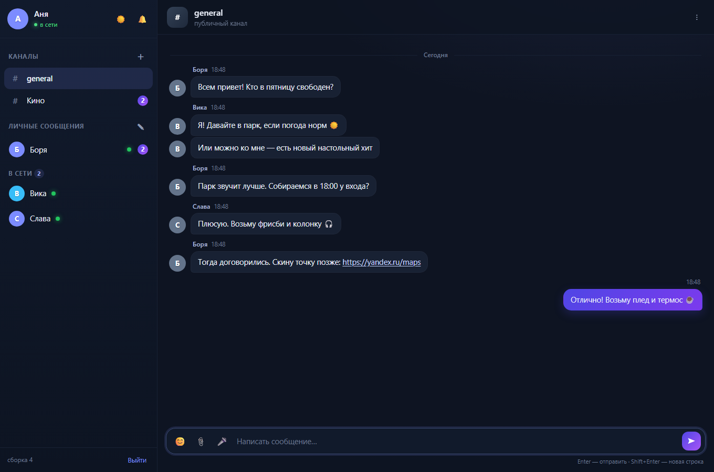

> **Сборка 4.** Теперь со входом по паролю, ответами и реакциями, голосовыми, профилем,
> светлой темой, поиском по чату и поддержкой TURN для звонков. Версию всегда видно
> в левом нижнем углу («сборка 4») и по адресу `/api/version`.

## Возможности

- **Вход по имени и паролю** — имя 2–20 символов, пароль 6–100 (хранится только как scrypt-хеш). Опционально — код доступа для круга друзей.
- **Вход по почте** — код из письма вместо пароля; аккаунт привязан к адресу.
- **Профиль** — своя аватарка (PNG/JPEG/GIF/WebP до 1 МБ) и статус «о себе» до 140 символов, видимые другим.
- **Каналы** — общий `general` и любые свои (`# Кино`, `# Дача`…).
- **Личные сообщения** — диалоги один на один; в списке только те, с кем уже есть переписка.
- **«В сети»** — кликабельный список: клик открывает личный чат. Кто уже есть в ЛС, второй раз не дублируется.
- **Действия с сообщениями** — ответ с цитатой, реакции эмодзи, правка своего («изменено»), удаление, копирование текста.
- **Голосовые сообщения** — запись с микрофона, отправка и воспроизведение с прогресс-баром.
- **Меню чата «⋮»** — поиск по текущей переписке, отключение уведомлений, информация о собеседнике или канале.
- **Онлайн-статус** и «был(а) в сети», индикатор «печатает…», счётчики непрочитанных и заголовок вкладки.
- **История** — хранится на сервере, подгружается порциями по 50 сообщений.
- **Картинки** — вставка из буфера, перетаскивание или выбор файла (до 5 МБ), просмотр в лайтбоксе.
- **Тёмная и светлая темы** — переключатель ☀️/🌙 в шапке сайдбара, выбор запоминается.
- **Звонки** — аудио и видео один на один из личного чата: WebRTC, сигналинг через тот же SSE, поддержка TURN.
- **Адаптивная вёрстка** — на телефоне чат открывается поверх списка, действия — по долгому нажатию.

<table>
  <tr>
    <td>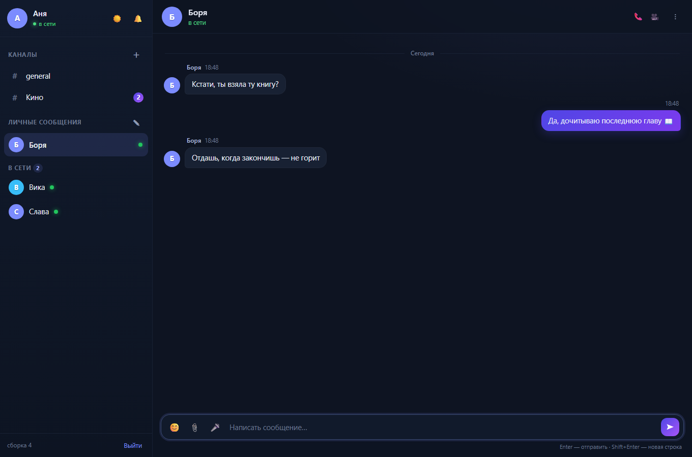</td>
    <td>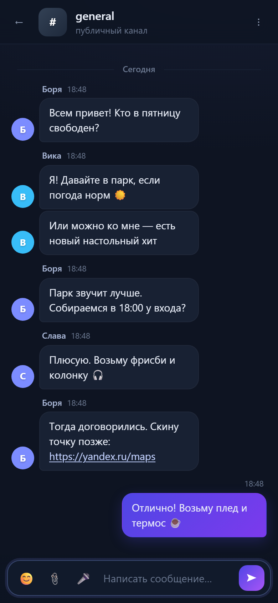</td>
  </tr>
  <tr>
    <td>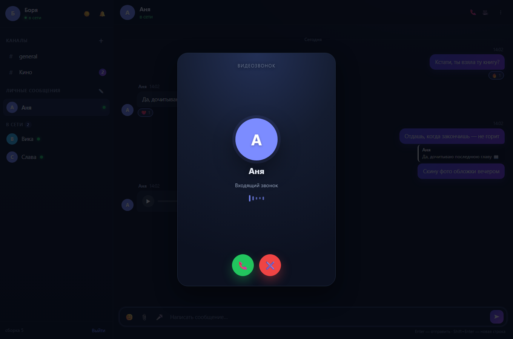</td>
    <td>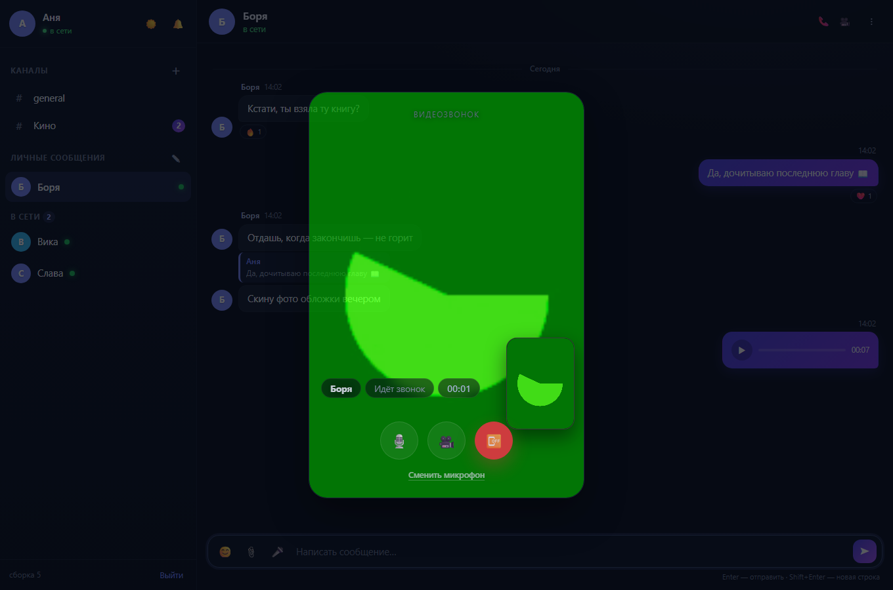</td>
  </tr>
  <tr>
    <td>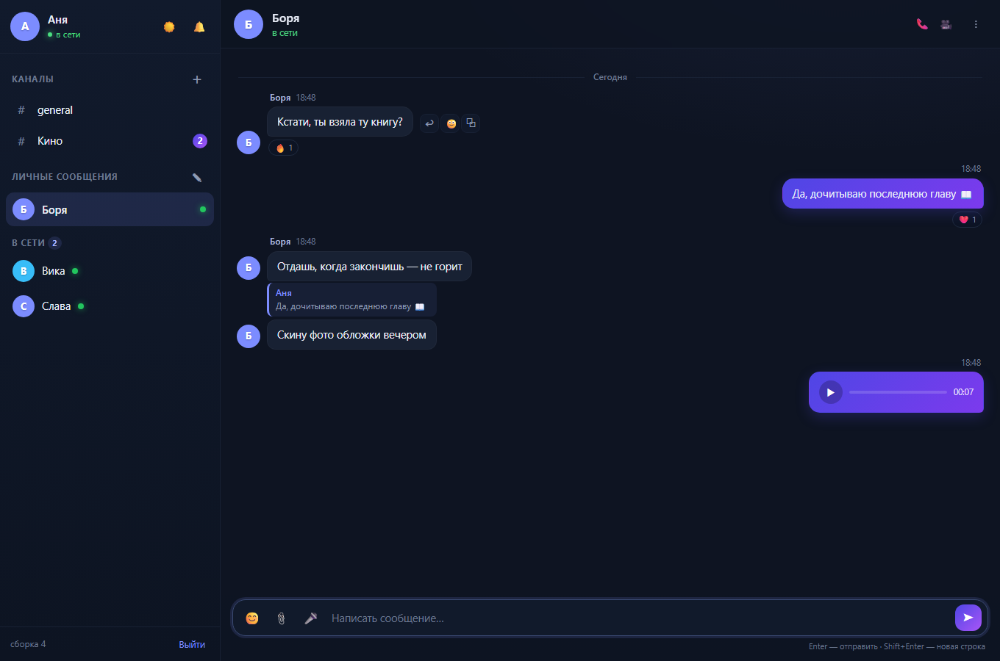</td>
    <td>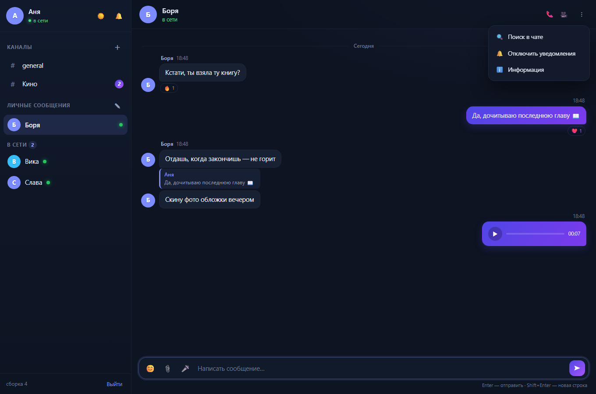</td>
  </tr>
  <tr>
    <td>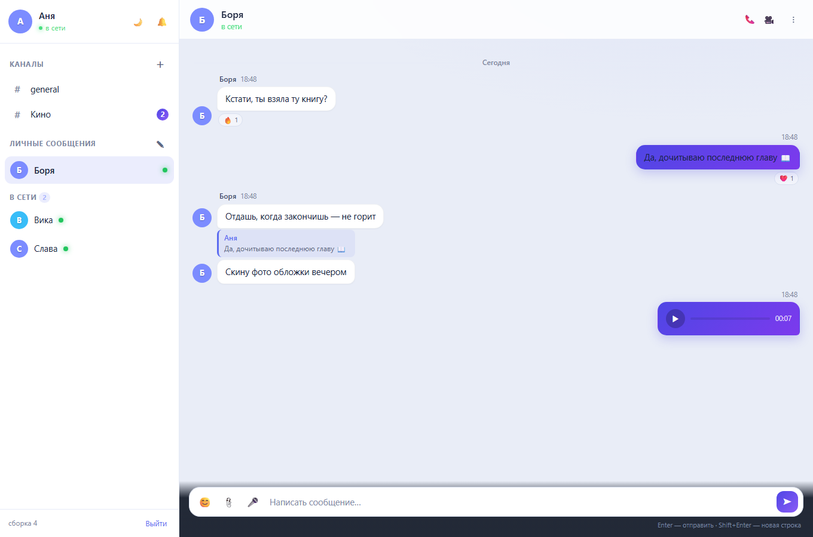</td>
    <td>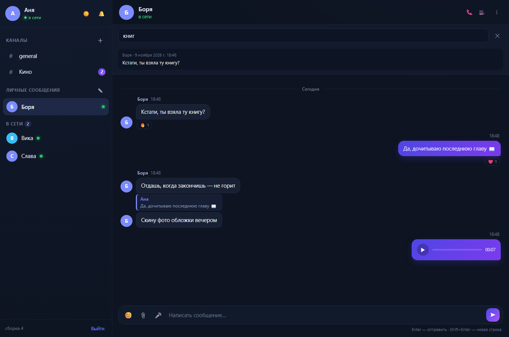</td>
  </tr>
</table>

## Запуск

Нужен [Node.js](https://nodejs.org) 18+.

```bash
cd friends-messenger
node server.mjs
```

Или двойным щелчком по **`start.cmd`** (Windows).

Сервер напечатает адреса:

```
Локально:   http://localhost:3210
В сети:     http://192.168.0.197:3210
```

Откройте ссылку «В сети» на телефоне или компьютере друга — они в той же Wi-Fi сети.
Первый вошедший создаёт себе имя; остальные просто вводят своё.

## Звонки

В личном чате рядом с именем собеседника есть две кнопки: 📞 — аудиозвонок, 🎥 — видеозвонок.
Второй участник видит входящий вызов и может принять или отклонить; во время разговора
доступны микрофон, камера (в видео) и кнопка завершения.

- Браузер отдаёт камеру и микрофон только на `https://` или на `localhost`. По локальной сети
  с телефона (`http://192.168.x.x:3210`) звонки не заработают — нужен https; на Render он есть сразу.
- Сигналинг идёт через `POST /api/call` по уже открытому SSE-потоку, а звук и видео — напрямую
  между браузерами по WebRTC. Медиа не проходят через сервер и нигде не записываются.
- Public STUN-серверы Google уже прописаны по умолчанию. Если у обоих участников «строгий»
  NAT и соединение не устанавливается, укажите свой TURN — сервер отдаст его клиенту
  в `/api/config`, интерфейс ничего не нужно менять:

  ```bat
  set TURN_URLS=turn:turn.example.com:3478,turns:turn.example.com:5349
  set TURN_USERNAME=друг
  set TURN_CREDENTIAL=секрет
  ```

  Подойдёт бесплатный [Metered](https://www.metered.ca/stun-turn) (Open Relay) или свой
  `coturn`. Без TURN звонки работают в большинстве домашних сетей.
- Звонок звонит 45 секунд, затем завершается сам; второй звонок во время разговора невозможен
  («Боря сейчас занят(а)»).

## Вход по почте

На экране входа есть вторая вкладка — «По почте». Вы вводите адрес, получаете письмо
с шестизначным кодом и входите без пароля. Имя для профиля берётся из адреса
(`anya@example.com` → «anya»), при совпадении добавляется номер.

<table>
  <tr>
    <td>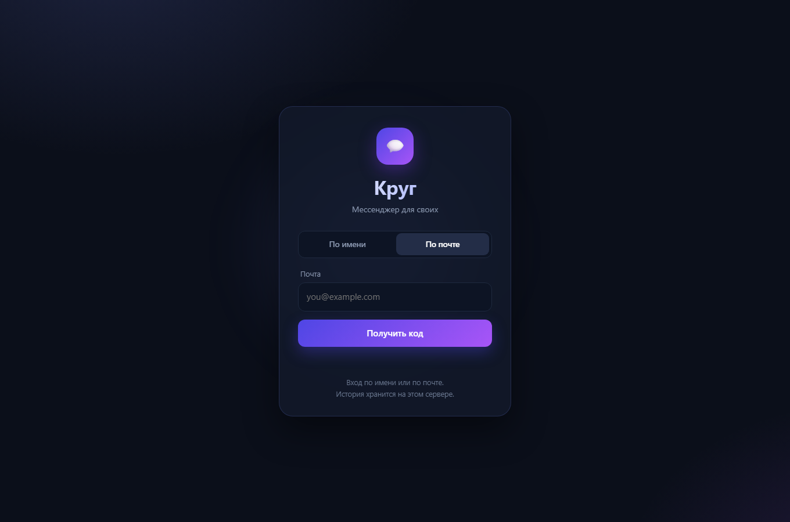</td>
    <td>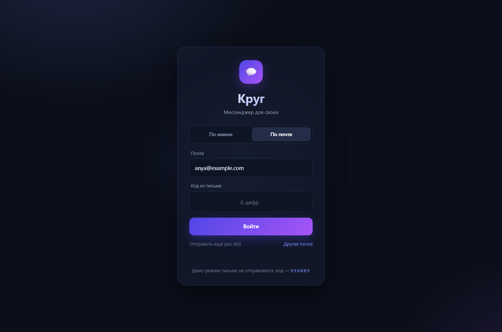</td>
  </tr>
</table>

Код живёт 10 минут, одноразовый, повторная отправка — не чаще раза в минуту
и не больше 5 писем в час на адрес.

### Настоящие письма (Resend)

1. Зарегистрируйтесь на [resend.com](https://resend.com) (есть бесплатный тариф).
2. Создайте API-ключ: **API Keys → Create API Key**.
3. Запустите сервер с ключом:

   ```bat
   set RESEND_API_KEY=re_ваш_ключ
   node server.mjs
   ```

По умолчанию письма уходят с адреса `onboarding@resend.dev` — он годится только для
проверки на почту владельца аккаунта. Чтобы писать друзьям, добавьте в Resend свой домен
(**Domains → Add Domain**, DNS-записи) и задайте отправителя:

```bat
set MAIL_FROM=Круг <hello@ваш-домен.ru>
```

### Демо-режим без почты

Если ключа нет, включите демо-режим — письмо не отправляется, а код появляется
на экране (удобно проверить вход и показать друзьям):

```bat
start-demo.cmd
```

или вручную: `set KRUG_DEV_MAIL=1`. Без ключа и без демо-режима вкладка «По почте»
просто скрыта — остаётся вход по имени.

## Настройки (переменные окружения)

| Переменная       | По умолчанию | Что делает                                            |
| ---------------- | ------------ | ----------------------------------------------------- |
| `PORT`           | `3210`       | Порт сервера                                          |
| `HOST`           | `0.0.0.0`    | Интерфейс; `127.0.0.1` — только с этого компьютера     |
| `FRIENDS_CODE`   | —            | Код доступа; если задан, без него войти нельзя         |
| `KRUG_DATA`      | `./data`     | Папка для базы и загруженных картинок                  |
| `RESEND_API_KEY` | —            | Ключ [Resend](https://resend.com): включает вход по почте |
| `MAIL_FROM`      | `Круг <onboarding@resend.dev>` | Отправитель писем                    |
| `KRUG_DEV_MAIL`  | —            | `1` — демо-режим: код показывается на экране, письма не уходят |
| `TURN_URLS`      | —            | TURN для звонков, через запятую (`turn:host:3478`)            |
| `TURN_USERNAME`  | —            | Логин TURN                                                     |
| `TURN_CREDENTIAL`| —            | Пароль TURN                                                    |

Пример для Windows (cmd):

```bat
set FRIENDS_CODE=наш-секрет
set PORT=3210
node server.mjs
```

## Где хранятся данные

```
data/
  db.json          — пользователи, каналы, сообщения, отметки о прочтении
  uploads/         — картинки (по одной на файл)
```

`db.json` перезаписывается атомарно (через временный файл) с задержкой ~200 мс,
а при остановке сервера (`Ctrl+C`) — синхронно. Резервная копия — просто скопировать папку `data`.

## Публикация на GitHub

Для Render нужен репозиторий на GitHub. Git устанавливать не обязательно — есть два пути.

### Одной командой (через API)

1. Создайте токен: GitHub → **Settings → Developer settings → Personal access tokens →
   Fine-grained tokens → Generate new token**. Дайте права **Contents: Read and write**
   и **Administration: Read and write** (второе — чтобы создать репозиторий).
2. Запустите:

   ```bat
   set GH_TOKEN=github_pat_ваш_токен
   node tools/push-github.mjs krug-messenger
   ```

Скрипт создаст публичный репозиторий (или обновит существующий), зальёт все файлы
одним коммитом и напечатает ссылку. Приватный: `set GH_PRIVATE=1`, другое имя
владельца/организации: `set GH_OWNER=...`.

### Вручную через сайт

1. GitHub → **New repository** → имя `krug-messenger`, **Public**, без README.
2. **Add file → Upload files**, перетащите содержимое папки проекта
   (не саму папку: `server.mjs`, `render.yaml`, `public/`, `test/`, `tools/`, `shots/`…)
   и нажмите **Commit changes**.
3. Папку `data/` не загружайте — это локальная история.

## Деплой на Render (доступ из интернета)

Локальный сервер работает в своей Wi-Fi сети. Чтобы друзья заходили из других сетей,
проще всего выложить проект на [Render](https://render.com) — он даёт HTTPS-адрес
и сам перезапускает сервис. Код к этому готов: порт берётся из `PORT`, проверка
живости — `/api/health`.

1. Загрузите проект в GitHub (можно через веб-интерфейс: **Add file → Upload files**;
   папки `data/` и `node_modules/` не нужны).
2. На Render: **New → Blueprint**, выберите репозиторий — Render прочитает `render.yaml`
   и создаст сервис. Либо вручную: **New → Web Service**, Runtime **Node**,
   Build Command оставить пустым, Start Command — `node server.mjs`.
3. В **Environment** задайте переменные: `FRIENDS_CODE` (код доступа),
   `RESEND_API_KEY` и `MAIL_FROM` (настоящие письма) или `KRUG_DEV_MAIL=1` (демо-режим).
   Для звонков между разными сетями добавьте `TURN_URLS`, `TURN_USERNAME`, `TURN_CREDENTIAL`
   (необязательно). Отдельной базы данных проекту не нужно — история лежит в JSON-файле
   в папке данных (см. ниже про диск).
4. Откройте выданный адрес вида `https://krug-xxxx.onrender.com`.

**Про данные.** На бесплатном тарифе диск не сохраняется: после перезапуска или
нового деплоя `data/db.json` и картинки начинаются с нуля. Чтобы история жила
постоянно, подключите **Disk** (платный инстанс): mount path `/var/data`,
переменная `KRUG_DATA=/var/data`. Бесплатный сервис ещё и засыпает без посетителей —
первое открытие после паузы занимает около минуты.

## Приложение на телефон (PWA и APK)

В проекте уже лежит всё, что нужно для установки «Круга» как приложения:

| Файл | Зачем |
| ---- | ----- |
| `public/manifest.webmanifest` | имя, иконки, `display: standalone`, цвета |
| `public/icons/icon-180/192/512/maskable-512.png` | иконки (генерируются `tools/make-icons.py`) |
| `public/sw.js` | service worker: сеть в приоритете, кэш только как запасной вариант офлайн |
| `public/index.html` | `<link rel="manifest">`, `apple-touch-icon`, meta для iOS |

Регистрация service worker включается только по HTTPS или на `localhost` — по
`http://192.168.x.x` браузер её не разрешит (это ограничение самих браузеров).

**Установить как приложение (без APK).** Откройте сайт по HTTPS (Render):

- Android, Chrome: меню ⋮ → **Установить приложение** (или «Добавить на главный экран»).
- iPhone, Safari: **Поделиться** → **На экран «Домой»**.

Иконка появится среди приложений, откроется без адресной строки. По локальному
адресу работает только ярлык «Добавить на главный экран» — это просто ссылка.

**Собрать APK (Android).** Нужен только браузер, Android Studio не требуется:

1. Задеплойте проект на Render и убедитесь, что `https://ваш-адрес/api/health` отвечает.
2. Откройте [pwabuilder.com](https://www.pwabuilder.com), вставьте адрес сайта, **Start**.
3. Проверьте, что все пункты зелёные (манифест, service worker, иконка 512 — они есть).
4. **Package for stores → Android → Download** — получите zip с `*.apk` (для установки
   вручную) и `*.aab` (для Google Play), плюс `assetlinks.json` для Render.

PWABuilder упаковывает сайт в Trusted Web Activity: APK открывает тот же адрес в
полноэкранном Chrome, поэтому обновления на сервере подхватываются сами, а новую
версию APK пересобирать не нужно. Единственное условие — телефон должен видеть
сервер: APK не обходит блокировки сети и не заменяет интернет-доступ.

## Как это устроено

| Часть        | Реализация                                                        |
| ------------ | ----------------------------------------------------------------- |
| Сервер       | `server.mjs`, модуль `node:http`, ноль зависимостей               |
| Реальное время | Server-Sent Events (`/api/events`), heartbeat каждые 25 с        |
| Хранилище    | JSON-файл в памяти + отложенная запись на диск                    |
| Клиент       | ванильный JS (`public/app.js`), без сборки и фреймворков          |
| Авторизация  | случайный токен в `localStorage`, передаётся в заголовке `x-token`|

### API

| Метод и путь                | Назначение                                       |
| --------------------------- | ------------------------------------------------ |
| `GET /api/config`           | что включено: код доступа, вход по почте, версия, ICE-серверы |
| `GET /api/health`           | проверка живости                                 |
| `GET /api/version`          | версия сборки и список возможностей              |
| `POST /api/join`            | вход/регистрация `{name, password, code}` → `{token, me}` |
| `POST /api/auth/email`      | отправить код на почту `{email, code?}` → `{ok, dev, code?}` |
| `POST /api/auth/verify`     | проверить код `{email, code}` → `{token, created, me}` |
| `GET /api/state`            | каналы, диалоги, пользователи, онлайн, непрочитанные |
| `GET /api/events?token=…`   | поток событий (SSE)                              |
| `GET /api/messages?conv=…`  | история, `limit` (1–100), `before` (timestamp), `q` — поиск |
| `POST /api/messages`        | отправка `{conv, text, image, audio, dur, replyTo}` |
| `PATCH /api/messages/:id`   | правка своего текста `{conv, text}`              |
| `DELETE /api/messages/:id`  | удалить своё сообщение (`?conv=…`)                |
| `POST /api/messages/:id/react` | реакция `{conv, emoji}` (переключается)       |
| `POST /api/me`              | профиль: `{status, avatar}`                      |
| `POST /api/mute`            | уведомления по чату `{conv, on}`                 |
| `GET /api/chat?conv=…`      | информация о собеседнике или канале              |
| `POST /api/read`            | отметить чат прочитанным `{conv}`                |
| `POST /api/typing`          | «печатает…» `{conv}`                             |
| `POST /api/rooms`           | создать канал `{name}`                           |
| `POST /api/dm`              | открыть диалог `{key}`                           |
| `POST /api/call`            | сигналинг звонка: `invite`, `accept`, `decline`, `hangup`, `offer`, `answer`, `ice` |

Ограничения: текст до 4000 символов, картинка до 5 МБ, голосовое до 8 МБ (не длиннее 10 минут),
аватар до 1 МБ, статус до 140 символов, не больше 20 сообщений за 10 секунд с одного токена
и 30 попыток входа за 10 минут с одного адреса. История каждого чата хранит последние
2000 сообщений.

## Тесты

```bash
node test/smoke.mjs
node test/email.mjs
node test/call.mjs
node test/features.mjs
```

`smoke.mjs` поднимает отдельный сервер на порту 3299 с временной папкой данных и проверяет
31 сценарий: вход, права доступа, отправку и историю, непрочитанные, личные чаты,
создание каналов, удаление сообщений, загрузку картинок, SSE и запись на диск.

`email.mjs` проверяет вход по почте в демо-режиме: 21 сценарий — отправка и повтор кода,
лимиты, неверный и одноразовый код, создание пользователя, уникальность имён,
код доступа и выключенный вход по почте.

`call.mjs` проверяет сигналинг звонков: 26 сценариев — занятость, офлайн, права (принять/завершить
может только участник), релей `offer`/`answer`/`ICE`, таймаут и повторные звонки.

`features.mjs` проверяет новые возможности: 38 сценариев — пароли (хеш, неверный пароль,
короткий пароль), лимит попыток входа, ответы с цитатой, реакции, правку и права на неё,
голосовые и аватары (сигнатуры файлов и лимиты), статус, отключение уведомлений,
информацию о чате, поиск и экранирование текста.

Скриншоты для документации (нужен Chrome или Edge):

```bash
node tools/screenshot.mjs
```

С включённым `KRUG_DEV_MAIL=1` и `KRUG_SHOT_EMAIL=1` скрипт дополнительно снимает
вход по почте и проверяет его в браузере. С `KRUG_SHOT_CALL=1` — открывает второе окно,
звонит из личного чата и снимает входящий звонок и видеосвязь (камера подменяется
встроенной заглушкой Chrome).

## Если что-то не так

- **`Порт 3210 уже занят`** — сервер уже запущен в другом окне. Откройте http://localhost:3210
  либо запустите на другом порту: `set PORT=3211` и снова `start.cmd`.
- **`Node.js not found`** — установите Node.js 18+ с [nodejs.org](https://nodejs.org);
  `start.cmd` сам найдёт встроенный Node из DeepSeek Harness, если он есть.
- **Друзья не открывают ссылку** — проверьте, что все в одной Wi-Fi сети и что в брандмауэре
  Windows разрешён Node.js (при первом запуске появляется запрос — нужно «Разрешить»).

## Ограничения

Это мессенджер для своих, а не защищённый корпоративный сервис:

- пароли хранятся как scrypt-хеши, но сквозного шифрования нет: на Render трафик идёт
  по HTTPS, а локальный сервер отдаёт обычный HTTP — не выставляйте его порт в интернет напрямую;
- история, картинки и голосовые лежат на компьютере (или в контейнере Render), где запущен сервер;
- push-уведомлений нет: вкладка должна быть открыта, звук и счётчики работают в ней.
